# Almagest 管线说明

本文从头到尾讲一张图片如何变成「一串转动的圆 + 一条参数方程」：每一步做什么、为什么这样做、参数在哪里调，以及对应哪段代码。

文中插图由 [`scripts/doc-figures.ts`](../scripts/doc-figures.ts) 生成。其中「真实数据」的图，是对一张合成的笑脸图实际跑一遍流水线得到的；其余是示意图。改了算法后可以这样重新生成：

```bash
npx vite-node scripts/doc-figures.ts
```

---

## 0. 总览

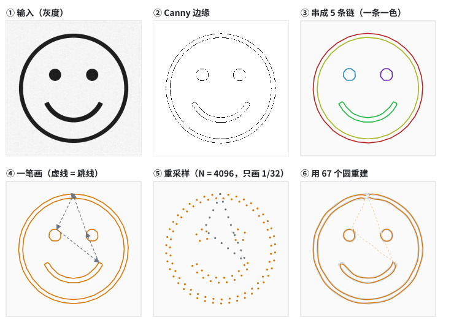

整条流水线分成两半：

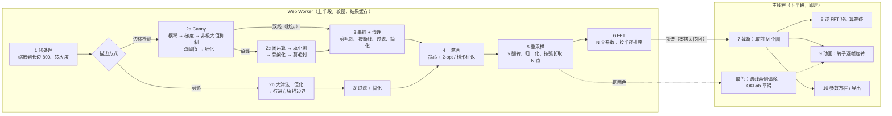

- **上半段**：从图片到频谱，耗时几十到几百毫秒，放在 Worker 里跑，不卡界面。结果以「图片哈希 + 描边方式 + 细致度 + 一笔画方式 + 跳线权重」为键缓存，切回之前的设置会立即出结果。
- **下半段**：只依赖频谱和圆数 M。拖动「圆的数量」时只重算这一半，所以能做到实时。

| 你改了什么 | 重跑哪些步骤 |
| --- | --- |
| 换图片 / 文字 / 描边方式 / 线条（双线、单线）/ 合并半径 r / 边缘细致度 / 一笔画方式 / 跳线加速 | 1–6（命中缓存时跳过），然后 7–10 |
| 笔迹颜色、取色偏移 d、最低亮度 | 只重新取色（毫秒级），不重跑流水线 |
| 圆的数量（档位、滑块、输入框） | 7–10 |
| 显示开关、速度、时间轴 | 只影响第 9 步的绘制 |
| 公式形式、小数位数 | 只影响第 10 步 |

代码位置：上半段的入口是 [`src/core/pipeline.ts`](../src/core/pipeline.ts)，Worker 外壳是 [`src/worker.ts`](../src/worker.ts)，下半段在 [`src/main.ts`](../src/main.ts)。

---

## 1. 预处理

代码：`src/main.ts` 的 `fromDrawable`，以及 [`src/core/edges.ts`](../src/core/edges.ts) 的 `toGray`。

1. **缩放**：把图片缩放到长边 800 像素（`TARGET_LONG_SIDE`）。缩放后，不论原图多大，后续阈值和耗时都差不多。
2. **铺白底**：透明区域当作白色。PNG 图标、抠过的图都会变成「白底上的图形」。
3. **转灰度**：亮度 = 0.299 R + 0.587 G + 0.114 B。
4. **算哈希**：对像素做 FNV-1a 哈希，作为缓存键的一部分。

另外两种输入：
- **文字输入**：先把文字用粗衬线体画到一张白底画布上，再走同样的流程，默认用剪影模式。
- **内置示例曲线**：圆、心形等。它们本身就是数学坐标下的闭合折线，直接跳到第 4 步，也不做 y 翻转。

---

## 2a. 边缘检测（Canny）

代码：`edges.ts` 的 `canny`、`thin`。

目标是得到 **1 像素宽、连贯** 的边缘线，供下一步沿着走。步骤如下：

1. **高斯模糊**：可分离卷积，核半径 3σ。σ 越大，细节和噪点被抹掉得越多（粗档 σ = 3，细档 σ = 0.8）。
2. **Sobel 梯度**：得到每个像素的梯度强度和方向。方向量化成 0°、45°、90°、135° 四档。
3. **非极大值抑制**：沿梯度方向和前后两个邻居比较，不是峰值就置 0。这一步把「粗边缘」压成 1 像素宽。
4. **双阈值 + 滞后连接**：强于高阈值的像素直接算边缘。介于高、低阈值之间的弱像素，只有通过 8 邻域连到强像素时才保留，这样既不会断线，也不会引入孤立噪点。
5. **去边框**：清掉最外 2 像素，避免把画面边框当成边缘。
6. **细化**：先做 Zhang-Suen 细化，再删掉台阶拐角上多余的像素。这样普通线上的每个点恰好有 2 个邻居，下一步就不会把它误判成交叉点。

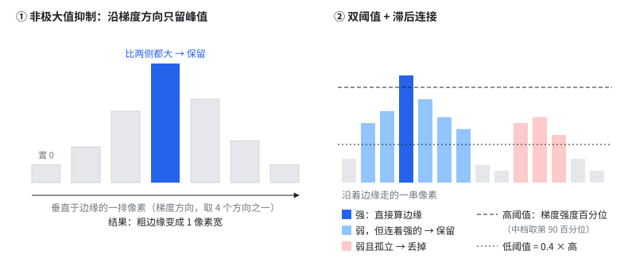

**阈值是自适应的**：高阈值取 **全图梯度强度的百分位**（粗 / 中 / 细三档分别是第 95 / 90 / 80 百分位），低阈值 = 0.4 × 高阈值。不同照片的对比度差别很大，用固定数值的阈值很难通用；按百分位取，相当于「保留最强的那 10%」。高阈值另设下限 0.08 × 最大梯度，防止几乎平坦的图片满屏都是噪点。

---

## 2b. 剪影（大津法 + 行进方块）

代码：`edges.ts` 的 `otsu`、`silhouetteMask`，以及 [`src/core/chains.ts`](../src/core/chains.ts) 的 `marchingSquares`。

适合 logo、文字、剪影这类「图形和背景分明」的图。剪影模式只描外轮廓（以及洞的轮廓），不会画出内部纹理，也不会出现边缘检测里「一条粗线被描成两条细线」的情况。

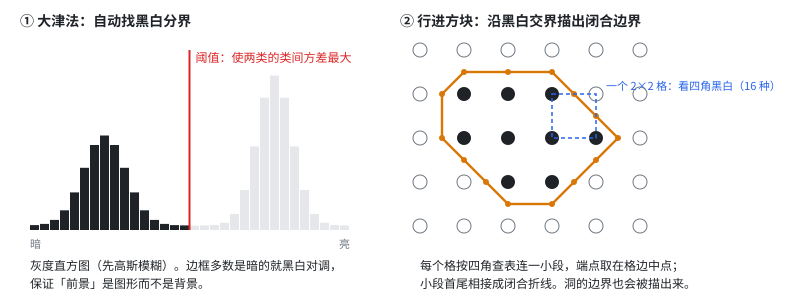

1. 先做高斯模糊，再用 **大津法** 自动选阈值：在灰度直方图上找一个分界点，使暗、亮两类的类间方差最大。
2. 比阈值暗的像素算前景。如果画面边框上多数像素是前景，说明前景其实是背景，就黑白对调。
3. **行进方块**：扫描每个 2×2 格，按四个角的黑白状态（共 16 种）查表连一小段，端点取在格边中点。这些小段首尾相接，构成闭合折线。洞的边界也会被描出来。

剪影模式得到的链本来就是闭合、干净的，所以跳过第 3 步里的剪毛刺和接断线，只做过滤和简化。

---

## 2c. 单线模式（可选，默认关）

代码：`edges.ts` 的 `mergeParallelEdges`、`fillSmallHoles`、`pruneSpurs`。界面：「描边方式」下的「线条：双线 / 单线」。

一条有粗细的黑色描线，Canny 会在它两侧各找到一条边，头发、棍子等处就出现平行的双线。单线模式在 Canny 之后、串链之前多做几步，把双线并成一条中心线：

1. **闭运算**：用半径 r 的圆盘先膨胀再腐蚀。相距小于约 2r 的两条平行边会被填成一条粗线；单独的边膨胀后又被腐蚀回来，基本不变。
2. **填小洞**：粗线拐角外侧的对角距离比 2r 大，闭运算在那里会留下一个小洞，骨架化后就成了一个小圈。所以把不连到画面边框、面积不超过 8r² 的背景区域填上。
3. **骨架化**：用 Zhang-Suen 细化把粗线压成 1 像素宽的中心线（和 2a 第 6 步是同一个函数）。
4. **剪毛刺**：骨架化会在拐角处长出短枝，删掉从交叉点伸出、长度小于 3r 的分支。

之后照常进入第 3 步串链。r 跟随细致度档位（粗 3、中 2、细 1.5 像素，按缩放后的图算），可以用「合并半径 r」滑块微调。描线比 2r 粗时仍会是双线，这时把 r 调大。单线结果和双线分开缓存。

---

## 3. 串链与清理

代码：`chains.ts` 的 `traceChains`、`cleanChains`、`joinChains`、`simplify`、`finalizeChains`。

边缘图只是一堆像素，这一步把它们串成 **有顺序的折线（链）**。

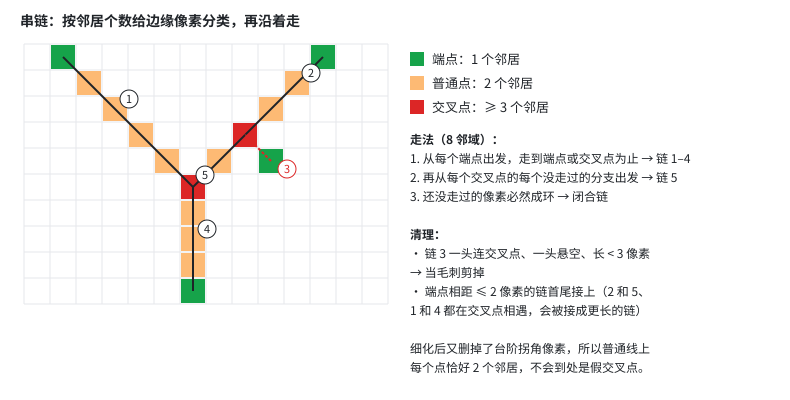

**走法**：先统计每个边缘像素在 8 邻域内的边缘邻居数，分成端点（1 个）、普通点（2 个）、交叉点（≥ 3 个）。然后分三轮走：
1. 从每个端点出发，一直走到另一个端点或交叉点。
2. 从每个交叉点的每个还没走过的分支出发，再走一遍。
3. 剩下没走过的像素一定构成环，从任一点出发走一圈，得到闭合链。

**清理**：

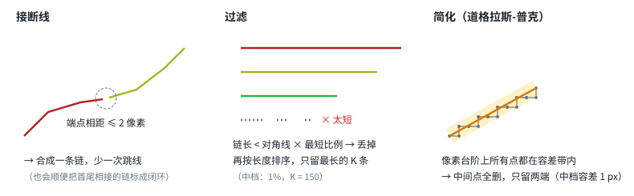

| 操作 | 规则 | 为什么 |
| --- | --- | --- |
| 剪毛刺 | 一端连着交叉点、另一端悬空，且长度 < 3 像素的链删掉 | 细化后常见的短刺，留着会多出很多跳线 |
| 接断线 | 两条链的端点相距 ≤ 2 像素就首尾接上（用网格哈希找邻近端点）；接完首尾相近的标为闭环 | 减少跳线 |
| 过滤 | 链长 < 对角线 × 最短比例就丢掉；按长度排序，只留最长的 K 条 | 去掉噪点碎线，控制规模 |
| 简化 | 道格拉斯-普克算法，容差 0.5 到 2 像素（随档位） | 把像素台阶拉成斜线，点数也大大减少 |

道格拉斯-普克算法：先连接首尾两点，找离这条线最远的点。如果最远距离超过容差，就保留这个点，并对它两侧递归处理；否则中间的点全部删掉。闭合链没有首尾，先取离起点最远的点把环切成两半，再分别处理。

---

## 4. 一笔画

代码：[`src/core/tour.ts`](../src/core/tour.ts)。

傅里叶级数只能画 **一条闭合曲线**，所以要把所有链首尾相连成一笔。链与链之间的连接线叫 **跳线**，会被单独标记出来，动画里画成淡色虚线或干脆隐藏。

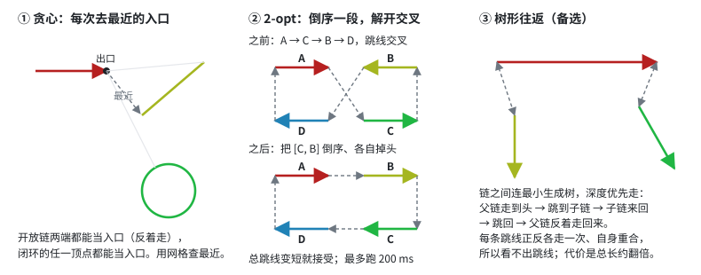

**默认：贪心 + 2-opt**（`greedyTour`）
1. 从最长的链开始。
2. 每走完一条链，就从出口找 **最近的入口**：开放链两端都能进（从另一端进就反着走），闭环的任一顶点都能进（从那里绕一圈再出来）。最近点用 64×64 的空间网格由近到远逐圈查找，不必逐个比较。
3. **2-opt 改进**：任取一段连续的链，整段倒序、每条链掉头，看总跳线长度是否变短，变短就接受。如此反复，直到没有改进或超过 200 毫秒。贪心得到的路径常有交叉的跳线，这一步通常能把它们解开。
4. 最后一条链的出口跳回起点，整条路径闭合。

**备选：树形往返**（`treeTour`，界面上的「树形往返」）
在链之间连一棵最小生成树（Prim 算法，连接点取开放链的两端、闭环的起点），然后深度优先遍历：父链走到头，跳到子链，子链来回走一遍，再跳回来。每条跳线正反各走一次、彼此重合，开放链也正反各走一遍，所以画面上看不出跳线，代价是曲线总长接近翻倍、需要更多的圆。

两种方式都会统计跳线条数和跳线占总长的比例，显示在「统计」里。

---

## 5. 重采样

代码：[`src/core/resample.ts`](../src/core/resample.ts)。

FFT 需要 **N 个时间上等间隔的点**。为了让笔匀速前进，这 N 个点要在曲线上 **按弧长等距** 分布，而不是沿用链上原有的顶点。

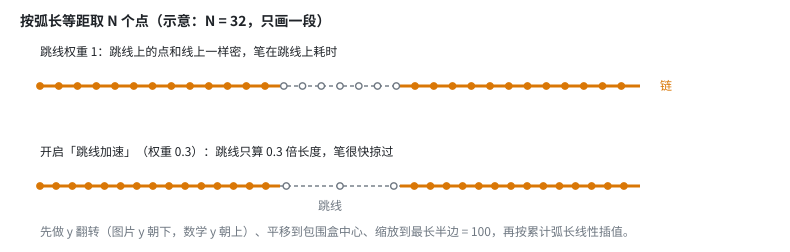

1. **y 翻转**：图片的 y 轴朝下，数学的 y 轴朝上。不翻转的话，画出来是倒的。
2. **归一化**：平移到包围盒中心，缩放到最长半边 = 100。这样不同图片的系数在同一个量级，公式里的数字也好读。缩放比例和中心记录在结果里，导出的 JSON 可以据此还原到像素坐标。
3. **按弧长取点**：先算累计弧长，再在 [0, 总长) 上均匀取 N 个位置，在所在线段上做线性插值。每个采样点继承所在线段的跳线标记。
4. **跳线加速**（可选）：计算弧长时，跳线只按 0.3 倍长度计。跳线上分到的采样点就少，笔会很快掠过；省下来的点留给真正的线条，细节更多。

N 随细致度档位取 2048 / 4096 / 8192（必须是 2 的幂）。

---

## 6. 傅里叶变换：把曲线拆成圆

代码：[`src/core/fft.ts`](../src/core/fft.ts)、[`src/core/fourier.ts`](../src/core/fourier.ts)。

把每个采样点看成一个复数 z<sub>n</sub> = x<sub>n</sub> + i·y<sub>n</sub>。离散傅里叶变换把这条曲线写成 N 个匀速转动向量之和：

$$z(t) = c_0 + \sum_k c_k\, e^{ikt},\qquad c_k = \frac{1}{N}\sum_{n=0}^{N-1} z_n\, e^{-ik\,2\pi n/N},\qquad t \in [0, 2\pi)$$

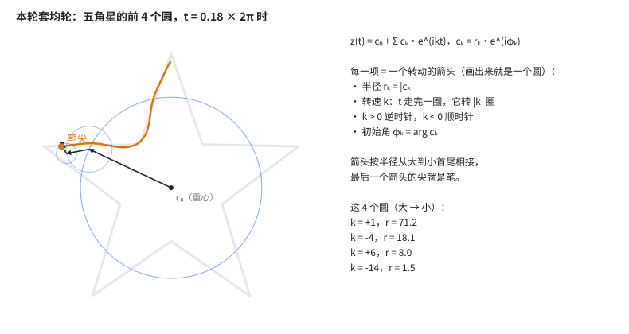

- **每一项就是一个圆**：c<sub>k</sub> = r<sub>k</sub>·e<sup>iφ<sub>k</sub></sup>。r<sub>k</sub> 是半径，φ<sub>k</sub> 是 t = 0 时箭头的角度，k 是转速：t 走完一圈，这个箭头转 |k| 圈；k > 0 逆时针，k < 0 顺时针。
- **c<sub>0</sub>** 不转，是所有采样点的平均位置（重心），也是第一个箭头的起点。
- **下标换算**：FFT 输出下标 m = 0 … N−1。m < N/2 对应 k = m；m ≥ N/2 对应 k = m − N，即顺时针的圆。
- **排序**：除 c<sub>0</sub> 外，所有项按半径从大到小排好，只排这一次。之后「取 M 个圆」就是取前 M 项，不用重算。箭头链也按这个顺序接：大圆在根部，小圆在笔尖。

FFT 用的是原地迭代的基 2 算法，旋转因子按长度预先算好缓存，避免递推累积浮点误差。取全部 N 项时，逆变换能精确还原输入，误差 < 10<sup>−9</sup>，单元测试有覆盖。

### 取多少个圆：能量截断

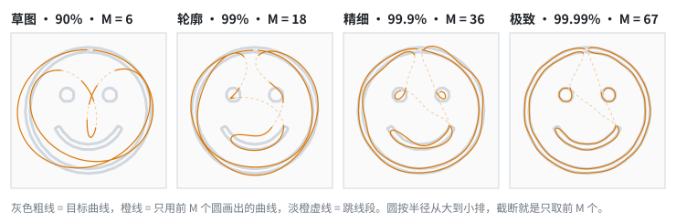

用 r<sub>k</sub><sup>2</sup> 衡量每个圆的「能量」。由帕塞瓦尔定理，所有圆的 r<sub>k</sub><sup>2</sup> 之和（不含 c<sub>0</sub>）等于采样点到重心距离平方的平均。所以「保留 99% 能量」可以直观理解为：被丢掉的那部分偏差，平方后只占曲线整体尺度的 1%。

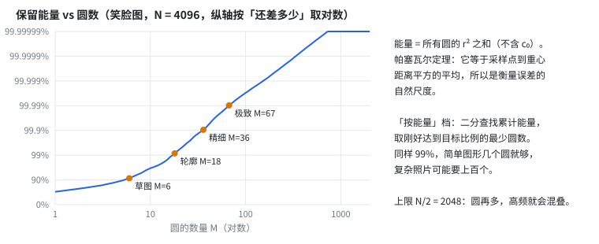

- **「按能量」档**：在累计能量数组上二分查找，取刚好达到目标比例的最少圆数。四档分别是 草图 90%、轮廓 99%、精细 99.9%、极致 99.99%。
- **「按个数」档**：直接取 10 / 50 / 200 / 1000 个圆。
- **上限 N/2**：圆数再多，高频分量就会混叠，因此滑块最多到 N/2。

同样是 99%，简单图形几个圆就够了（正方形 2 个、心形 5 个），复杂照片可能要上百个。用能量当标准，就不必为每张图手动挑圆数。

---

## 7–9. 动画

代码：`src/main.ts` 的「动画」和「绘制」两节，以及 [`src/glCircles.ts`](../src/glCircles.ts)。

### 转子：每帧一次复数乘法

如果每帧都对每个圆算一次 cos / sin，圆多了就会很慢。实际做法是为每个圆维护一个单位复数 **转子** e<sup>ikt</sup>，每帧乘上一个固定的步进因子 e<sup>ik·Δt</sup>，也就是一次复数乘法（4 次乘、2 次加）。Δt 由速度档位决定：速度档是「几秒画完一圈」（60 / 30 / 20 / 12 / 8 / 4 / 2 秒），按 60 帧每秒折算。

连乘会累积浮点误差，所以每画完一圈、或者拖动时间轴时，都用 cos / sin 重新校准一次转子。

箭头链的节点 = c<sub>0</sub> 加上前 j 项之和，逐项累加就能得到所有节点，最后一个节点就是笔尖。

### 笔迹：预计算，按 t 揭开

笔迹不靠逐帧记录笔尖位置，而是在 M 变化时做一次 **逆 FFT**（把前 M 个系数放回长度 N 的数组），一次得到 N 个笔迹点。画的时候揭开到当前时刻，再连到笔尖。这样拖动时间轴、改速度都不会让笔迹断掉或出现锯齿。

跳线所在的采样段有三种画法：淡色虚线、隐藏、实线，由「跳线」选项决定。

### 按原图颜色上色（可选，默认关）

代码：[`src/core/colorize.ts`](../src/core/colorize.ts)，以及 `main.ts` 的 `recolor`、`paintColoredTrace`。界面：「显示」下的「颜色：单色 / 原图色」、取色偏移 d、最低亮度。

1. **记住像素坐标**：重采样时，每个采样点除了归一化后的坐标，还记下它在缩放后原图上的像素坐标 `px`、`py`。
2. **沿法线向两侧取色**：边缘点通常落在黑色描线上，单线模式下骨架更是正好在描线中心，直接取该像素只会得到黑色。所以先用前后各 2 个采样点估计切线，再沿法线向两侧各偏移 d 像素取色（默认 4；单线模式下自动保证 d ≥ r + 1）。
   - 透明度低于 0.5、或 OKLab 亮度低于 0.2（接近黑色）的颜色无效。
   - 两侧都有效时，取饱和度（OKLab 色度）更高的一侧；都无效时向外再走最多 3 步；仍然找不到就用默认笔迹色。
3. **平滑**：沿曲线做 5 个点的滑动平均。平均在 OKLab 里做（感知均匀，混出来的颜色不脏），不跨越跳线，也不混入没取到颜色的点。
4. **最低亮度**（可关）：比下限暗的颜色，只把亮度提到下限，色相和色度不变。例如深藏青的短裤会画成灰蓝，而不是在深色背景上看不见。
5. **对齐**：逆 FFT 得到的第 n 个笔迹点，和第 n 个采样点一一对应，直接用它的颜色。所以圆数变化时颜色不用重算，「逐渐加圆」也能直接用。
6. **常驻笔迹层**：彩色笔迹画在一块离屏画布上，每帧只补画新揭开的几段，再贴到主画布上。只有笔迹、颜色、镜头、尺寸或跳线样式变了，或者往回拖了时间轴，才整体重画一次。「统计」里会显示整体重画的次数。镜头跟随模式下画面每帧都在移动，所以每帧都会整体重画。跳线不上色，仍按「跳线」选项画。

### 画圆：WebGL2 实例化

- 半径小于 0.5 像素的圆不画（它们仍然参与求和，只是看不见）。
- **有 WebGL2 时**：剩下的圆一次实例化绘制到离屏画布，再合成到主画布，所以图层顺序和视频录制都不受影响。完全在画面外的圆，以及把整个画面都包在里面的圆（看不到圆环），都会被剔除。
- **没有 WebGL2 时**：退回 Canvas 2D，只画半径最大的 200 个。
- 箭头最多给前 80 段画箭头头部；屏幕上短于 10 像素的不画头部。

### 镜头跟随与逐渐加圆

- **镜头跟随笔尖**：放大 6 倍，镜头平滑地追着笔尖移动，适合看小圆怎样修细节。
- **逐渐加圆**：从 1 个圆开始，每 3 帧把圆数加约 6%（至少加 1 个），每次都重算一遍笔迹。加满后停留约 2.5 秒，再从头开始。可以直观看到曲线怎样从一个圆逐渐逼近目标。

---

## 10. 参数方程与导出

代码：[`src/core/equation.ts`](../src/core/equation.ts)、[`src/gif.ts`](../src/gif.ts)。

公式只用当前保留的 M 个系数，项的顺序和动画一致（半径从大到小）。下面以内置心形取 M = 3、半径 1 位小数、相位 2 位小数为例，这是实际程序输出：

**复数形式**：每项就是一个圆，最贴近动画。

$$z(t) = (0.0 + 20.5i) + 82.2\,e^{i(-t + 1.57)} + 11.1\,e^{i(2t - 1.57)} + 10.1\,e^{i(-3t - 1.57)}$$

**分坐标 · 相位**：把每项的实部、虚部分开写，x、y 各一行。

$$\begin{aligned}
x(t) &= 0.0 + 82.2\cos(-t + 1.57) + 11.1\cos(2t - 1.57) + 10.1\cos(-3t - 1.57) \\
y(t) &= 20.5 + 82.2\sin(-t + 1.57) + 11.1\sin(2t - 1.57) + 10.1\sin(-3t - 1.57)
\end{aligned}$$

**分坐标 · 三角级数**：把 +k 和 −k 两项合并，只剩正频率的 cos、sin，也就是教科书上的写法。

$$\begin{aligned}
x(t) &= 0.0 + 82.2\sin t + 11.1\sin 2t - 10.1\sin 3t \\
y(t) &= 20.5 + 82.2\cos t - 11.1\cos 2t - 10.1\cos 3t
\end{aligned}$$

合并公式：设 c<sub>k</sub> = a + bi，c<sub>−k</sub> = g + di，则

$$x \mathrel{+}= (a+g)\cos kt + (d-b)\sin kt,\qquad y \mathrel{+}= (b+d)\cos kt + (a-g)\sin kt$$

格式细节：负数写成减号；k = ±1 时省略系数 1；相位按精度四舍五入后为 0 就省略；每行 4 项；超过 12 项时页面上只显示前 8 项，可以点「展开全部」。

**导出**：

| 按钮 | 内容 |
| --- | --- |
| 复制 LaTeX | 当前形式的完整公式（不折叠） |
| Desmos 表达式 | 纯文本参数式 `(x(t), y(t))`，在 Desmos 里把 t 的范围设成 0 到 2π |
| 系数 JSON | 每项的 k、r、φ，加上 N、缩放比例、中心、图片高度，可以在别的引擎里重放动画或还原到像素坐标 |
| 导出 GIF | 离屏 480×480 逐帧渲染，沿用「显示」里的全部选项。普通模式画一圈 120 帧再定格；逐渐加圆模式下每帧加约 6% 的圆，加满后定格。整段动画共用一张全局调色板，避免逐帧闪色 |
| 录制一圈视频 | 直接录制屏幕上的画布，画完一圈自动停止并下载 |

---

## 附：档位参数

代码：[`src/core/presets.ts`](../src/core/presets.ts)。这些数值是起始值，还需要用真实照片继续调。

**边缘细致度**（决定目标曲线，改了要重跑上半段）：

| 档位 | 模糊 σ | 高阈值百分位 | 最短链长（占对角线） | 简化容差 | 最多链数 K | 采样点 N | 单线半径 r |
| --- | --- | --- | --- | --- | --- | --- | --- |
| 粗 | 3.0 | 95% | 5% | 2 px | 30 | 2048 | 3 px |
| 中 | 1.5 | 90% | 1% | 1 px | 150 | 4096 | 2 px |
| 细 | 0.8 | 80% | 0.2% | 0.5 px | 600 | 8192 | 1.5 px |

**圆的数量**（决定逼近程度，只重算下半段）：

| 档位 | 按能量 | 按个数 |
| --- | --- | --- |
| 草图 | 90% | 10 |
| 轮廓 | 99% | 50 |
| 精细 | 99.9% | 200 |
| 极致 | 99.99% | 1000 |
